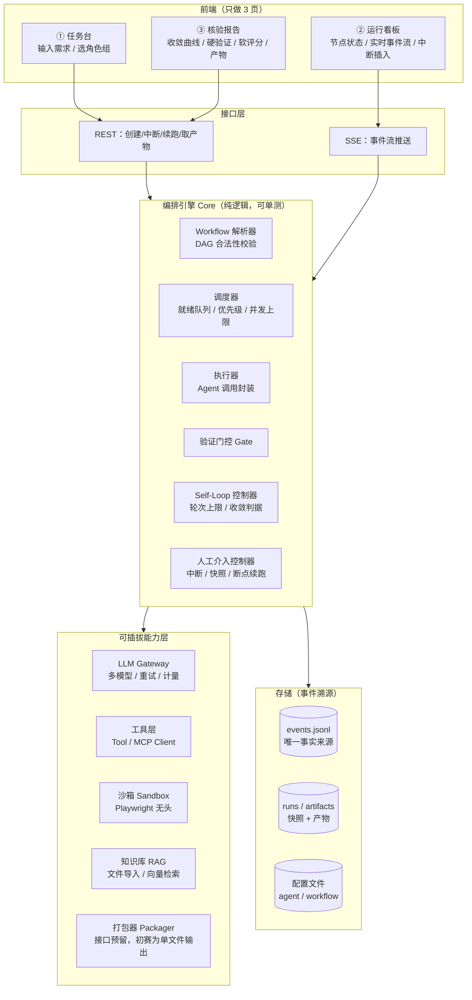
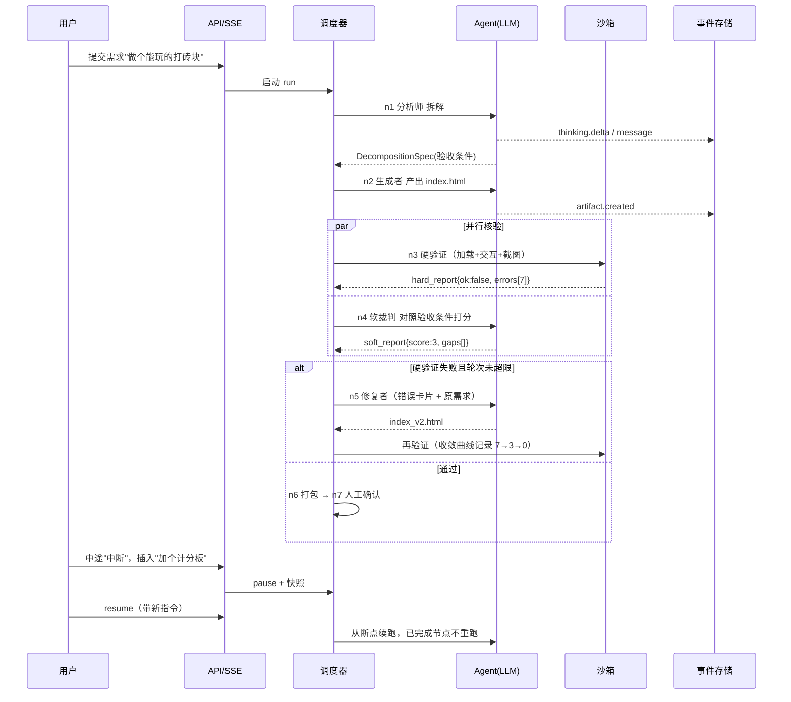

# 需求规格书 v0.3 —— Agent 编排调度平台

> 第五届"未来杯"创新大赛 · 赛题一（Agent 编排创新应用）
> 本文档是**给实现方（pro）的契约**，不是方案书。方案书从这份规格派生。

---

## 0. 定稿决策（已确认，不再讨论）

| 项 | 定稿 |
|---|---|
| 主战场 | 一句话需求 → 可运行的**单文件 HTML/JS 小游戏/小工具** |
| 产物约束 | **无后端、无 npm、无构建步骤**，单个 `.html` 文件（可内联 CSS/JS） |
| 核验方式 | 无头浏览器（Playwright）加载 + 捕获 `console.error`/`pageerror` + 脚本化交互 + 截图 |
| 旁证线 | 同一引擎换配置跑「文献引用核验」，只做 1 个案例，仅证明通用性 |
| 通用性 | 由**架构**（配置驱动）体现，不由功能数量体现 |
| exe | 不作为初赛交付物；架构预留 `Packager` 接口 + 空实现 |
| 交付周期 | 11 天，solo，人工约 2h/天 |

### 范围红线（明确不做）

拖拽画布编辑器 · 节点/插件市场 · API 余额显示 · 本地模型接入 · Agent 自动发现（A2A）· 多模态输入输出 · 账号与多租户 · 权限体系 · 任意语言/框架产物 · exe 打包实现

> 判据：**每个功能必须在 3~5 分钟演示视频里有一个镜头**，分镜排不上的不做。

---

## 1. 系统定位（一句话）

**一个配置驱动的多智能体编排引擎：把一句话需求，经"拆解 → 生成 → 硬核验 → 回灌修复"的闭环，交付一个确定可运行的软件产物，且全过程可观测、可中断、可复现。**

关键叙事（答辩口径）：
> 我们不是"又一个 Agent 聊天框"。我们的差别在于**产物的验收是机器判定的**：编译器/运行时说不行就是不行，Agent 无法自我说服。LLM 只负责"生成"和"评价好不好玩"，不负责"判定能不能跑"。

---

## 2. 总体架构



### 架构的核心决定：事件溯源（Event Sourcing）

**所有状态都从一条 append-only 的事件流派生**，不另存"当前状态表"。

这一个决定同时满足赛题的四项要求，且实现成本最低：

| 赛题要求 | 由事件流如何满足 |
|---|---|
| 执行日志 | 事件流本身就是日志 |
| 状态快照 / 可复现 | 事件流 + 产物 hash 可完整重放一次运行 |
| 实时监控 / 中间结果捕获 | SSE 直接转发事件；前端不需要轮询 |
| 轨迹（时长、轮次、调用） | 对事件流做聚合查询即可 |
| 中断后断点续跑 | 快照 = 截至中断点的事件序列 |

---

## 3. 核心数据模型

### 3.1 AgentProfile（角色定义）

```jsonc
{
  "id": "analyst",
  "name": "分析师",
  "version": "1.0.0",              // 版本管理：同 id 多版本可共存
  "role_prompt": "……",
  "thinking_effort": "medium",     // low | medium | high（映射到不同模型/温度/提示）
  "model": { "provider": "deepseek", "name": "deepseek-chat", "temperature": 0.3 },
  "capabilities": ["decompose", "spec"],   // 能力标签 → 供调度器做匹配
  "tools": ["web.fetch"],                  // 允许使用的工具白名单
  "memory": { "scope": "run", "retrieve_top_k": 4 },
  "output_schema": "DecompositionSpec",    // 强制结构化输出的 schema 名
  "io": { "inputs": ["requirement"], "outputs": ["spec"] }
}
```

> 说明：`capabilities` 是**智能调度的依据**——同一类任务有多个候选 Agent 时，按能力标签匹配 + 历史成功率 + 平均耗时 + 成本做打分选择。这是"调度算法"能写成一套东西的地方。

### 3.2 WorkflowDef（工作流定义，DAG）

```jsonc
{
  "id": "game-gen-v1",
  "name": "小游戏生成闭环",
  "nodes": [
    { "id": "n1", "type": "agent",  "agent": "analyst",  "inputs": ["req"],        "outputs": ["spec"] },
    { "id": "n2", "type": "agent",  "agent": "builder",  "inputs": ["spec"],       "outputs": ["artifact"] },
    { "id": "n3", "type": "verify", "verifier": "hard-sandbox", "inputs": ["artifact"], "outputs": ["hard_report"] },
    { "id": "n4", "type": "agent",  "agent": "critic",   "inputs": ["artifact","spec"], "outputs": ["soft_report"] },
    { "id": "n5", "type": "agent",  "agent": "fixer",    "inputs": ["spec","hard_report","artifact"], "outputs": ["artifact"] },
    { "id": "n6", "type": "packager","packager": "single-html", "inputs": ["artifact"], "outputs": ["bundle"] },
    { "id": "n7", "type": "human",  "when": "always",    "note": "可中断插入点" }
  ],
  "edges": [
    { "from": "n1", "to": "n2" },
    { "from": "n2", "to": "n3" },
    { "from": "n2", "to": "n4", "parallel": true },
    { "from": "n3", "to": "n5", "when": "fail", "loop": { "max_iters": 3, "to": "n3" } },
    { "from": "n3", "to": "n6", "when": "pass" },
    { "from": "n5", "to": "n3" },
    { "from": "n6", "to": "n7" }
  ],
  "limits": { "max_total_iters": 6, "timeout_sec": 900, "max_concurrency": 4 }
}
```

**必须支持的控制结构**（赛题原文逐条对应）：

| 结构 | 实现方式 |
|---|---|
| 顺序 | 单边链 |
| 并行分支 | 同一 `from` 多条边 + `parallel: true` |
| 条件判断 | edge 的 `when: always / pass / fail` |
| 循环迭代 | edge 回边 + `loop.max_iters` |
| 子工作流嵌套 | node `type: "subflow"`，引用另一个 WorkflowDef |

> 循环不在 DAG 上做特殊处理：**回边在运行时被调度器当作"重新入队的节点"**，靠 `loop` 计数与全局 `max_total_iters` 兜底。这样既保留 DAG 的静态校验能力，又支持迭代。

### 3.3 Event（事件，唯一事实来源）

```jsonc
{ "seq": 1024, "ts": 1762668000123, "run_id": "r_01J...", "node_id": "n2", "agent_id": "builder",
  "type": "agent.thinking.delta", "payload": { "text": "先画一个 16x16 的网格…" } }
```

事件类型清单（枚举，实现时不要随意扩展）：

| 类型 | 用途 |
|---|---|
| `run.started` / `run.finished` / `run.failed` | 运行边界 |
| `node.entered` / `node.exited` | 节点状态、时长统计（轨迹） |
| `agent.thinking.delta` / `agent.message` | **气泡与实时流的数据源** |
| `agent.tool.call` / `agent.tool.result` | 工具调用轨迹 |
| `artifact.created` | 产物落盘（带 sha256） |
| `verify.hard.result` / `verify.soft.verdict` | 两类核验结果 |
| `loop.iteration` | 轮次计数（收敛曲线数据源） |
| `run.interrupted` / `run.resumed` | 人工介入 |
| `human.instruction` | 用户注入的指令/改需求 |
| `error` | 异常 |

### 3.4 RunRecord / 快照

```jsonc
{
  "run_id": "r_01J...", "task_id": "t_007", "workflow_id": "game-gen-v1",
  "status": "running|paused|done|failed|aborted",
  "model_snapshot": [{ "agent_id": "builder", "model": "deepseek-chat", "prompt_hash": "…" }],
  "seed": 42,
  "artifacts": [{ "id": "a1", "path": "runs/r_01J/a1.html", "sha256": "…" }],
  "metrics": { "wall_ms": 94000, "tokens": 51234, "cost_usd": 0.09,
               "rounds": 3, "error_curve": [7, 3, 0] }
}
```

> `model_snapshot` + `seed` + 产物 `sha256` = **可复现三件套**。方案书"可复现性"那一节就写这个。

---

## 4. 主链路时序



---

## 5. 模块职责与接口契约

### 5.1 引擎 Core（纯逻辑，无 IO 副作用，必须可单测）

```ts
interface Engine {
  start(workflow: WorkflowDef, task: TaskInput): RunId;
  interrupt(runId: RunId): void;                    // 请求中断，处理完当前 LLM 调用后暂停
  resume(runId: RunId, instruction?: string): void;  // 带新上下文续跑
  subscribe(runId: RunId, cb: (e: Event) => void): Unsubscribe;
}
```

约束：
- 引擎**不直接调 LLM、不直接开浏览器**，全部通过注入的接口。这样 11 天内可以先用 fake 跑通全链路，再换真实现。
- 调度器必须暴露 `pickAgent(node, candidates[])` 这一层，实验才能对比"串行基线 vs 智能调度"。

### 控制面红线（违反即返工）

| # | 红线 | 理由 |
|---|---|---|
| R1 | 节点跳转只能由 **WorkflowDef + 状态机**决定，**禁止让 LLM 决定"下一位谁执行"** | LLM 只产出结构化数据，不得改变拓扑。否则退化成不可控的群聊 |
| R2 | **错误归一化 / 状态聚合 / 结果归约（Reducer）必须是确定性代码，不得调用 LLM** | 归约器一旦用 LLM，噪声会被放大成错误，且不可复现 |
| R3 | 任何循环必须有**双重上限**：`loop.max_iters`（局部）+ `limits.max_total_iters`（全局） | 单层上限挡不住"外层套内层"的乘法爆炸 |
| R4 | 所有节点输出必须过 **schema 校验**，校验失败按 `error` 事件处理，不得静默透传 | 上游幻觉会被下游当事实用 |

### 5.2 沙箱 Sandbox（硬验证，不含 LLM）

```ts
interface Sandbox {
  run(html: string, opts: { timeoutMs: number; interactionScript?: Action[] }): Promise<HardReport>;
}

type HardReport = {
  ok: boolean;
  load_ok: boolean;            // 页面能否加载完成
  errors: Array<{ type: 'console'|'pageerror'|'timeout'; message: string; stack?: string; line?: number }>;
  signals: { canvas_nonempty: boolean; dom_node_count: number; fps_sample?: number };
  screenshots: string[];       // 首屏 + 交互后
  load_ms: number;
};
```

**硬验证的判定规则（必须写死，不许含糊）**：

```
ok = load_ok
  && errors.length === 0
  && signals.canvas_nonempty        // 若需求声明为图形类
  && interactionScript 全部未抛错
```

> 这条规则是整份方案的支点：它使"可运行率"成为一个**可机器计算、可复现、不可争辩**的数字。方案书里必须同时写明它的局限：它只能证明"能跑"，不能证明"好玩/完成度高"，后者交给软裁判与人评。**主动写局限 = 评分细则里"有误差、局限的讨论"那一项的分。**

### 5.3 Self-Loop 控制器（灵魂模块）

```
loop:
  生成/修复 → 硬验证 → 若 ok 则出关
  → 失败则"错误归一化"：把 7 条报错压成 ≤3 张错误卡片
     （分类：语法/运行时/渲染/交互/资源，附行号与截图）
  → 回灌给修复者：错误卡片 + 原需求 + 上一版产物摘要（不放全文，控 token）
  → 计数 +1
收敛判据（四条，全部要落进代码）：
  1. 轮次上限 3（硬上限，防死循环）
  2. **调用指纹去重**：记录 hash(node_id + 规范化(payload))，同一 run 内出现重复或
     语义高相似（错误卡片集合相同）的调用，直接判"卡住"
     → 防"修复者在同一个错误上反复微调标点"的伪进展
  3. 连续两轮错误数不下降 → 判定"卡住"，升级策略：
     换更细的子任务拆分 / 提高 thinking_effort / 请求人工介入
  4. 超限则**带缺陷交付**：输出可运行的最佳版本 + 缺陷报告，绝不假装成功
```

**关于判据 2 的现实依据**：LLM 在被反复要求"再改一次"时会陷入"防御性妥协"——每次都微调一点、看起来在努力，实际不动。仅看"错误数是否下降"抓不住它（错误数可能从 7 变 6 再变 5，看似在收敛）。指纹能。

> 第 3 条非常重要：决赛评分有"错误恢复"和"收敛速度"。**"失败了但知道为什么、并把残次品和病历一起交出来"，比"无限重试最后超时"分数高得多。**

### 5.4 中断 / 插入 / 续跑（差异化功能）

状态机：

```
running --interrupt()--> interrupting --(本次 LLM 调用返回)--> paused --resume(instruction)--> running
                                                              └── 允许在 paused 期间：
                                                                   · 修改需求
                                                                   · 改某个 Agent 的 prompt
                                                                   · 跳过/重跑某个已完成节点
```

实现要点（**v0.3 修订：改为异步全双工，不再"等当前调用返回"**）：

- **长耗时操作全部异步化**：LLM 调用与沙箱执行都走 `start → (后台执行) → finish 事件回流` 两段式。发起后立即返回 `started`，不阻塞调度循环。
  > 理由：沙箱一次 10~30 秒、LLM 一次 20~60 秒，若"等当前调用返回才暂停"，演示时点下中断要愣半分钟，非常难看，而且用户在这半分钟里打的新指令会被吞掉。
- **中断不杀进程、也不等在途调用**：立刻停止调度新节点，已发出的调用继续在后台跑完并把结果落进事件流（标 `orphan: true`，不进主链路）。
- **全双工**：`paused` 期间用户仍可继续输入，指令进队列；`resume` 时按序注入。
- `paused` 快照 = 事件流末尾位置 + 各节点最新输出引用。
- `resume` 时把 `human.instruction` 作为一条**高优先级消息**注入下一个 Agent 的上下文，并记录为事件（这样它能出现在日志、报告和答辩演示里）。

### 5.5 打包器 Packager（exe 的落点）

```ts
interface Packager {
  pack(artifact: Artifact): Promise<Bundle>;   // Bundle = { files[], entry, run_hint }
}
```

初赛实现：`SingleHtmlPackager` → 输出 `index.html` + `README.txt`（双击即玩）。
预留：`TauriPackager` / `ElectronPackager` 空实现，方案书标注为 roadmap。

### 5.6 通用性旁证：引用核验配置

同一引擎，换 `WorkflowDef` 与 `AgentProfile`：

| 小游戏产线 | 引用核验产线 |
|---|---|
| Analyst → Builder → HardSandbox → Critic | Analyst → Retriever → Writer → **CitationChecker** → Critic |
| 硬验证：能否加载运行 | 硬验证：DOI/URL 能否解析、命中文本是否含该论断关键词 |

前端、调度器、事件流、Self-Loop、报告页**完全复用**——这就是通用性的证明，一行引擎代码不用改。视频结尾 15 秒讲这个即可。

### 5.7 上下文管理（防 Token 雪崩）

多 Agent 最常见的死法不是能力不够，是**上下文滚雪球**：A 说完 B 带着全史回，B 说完 C 把前两人的长篇大论全抄进 Prompt，三轮下来单次请求冲到 30k token。

规则：

| 规则 | 说明 |
|---|---|
| **上下文切片** | 每个节点只收到它声明需要的 port（见 `node.inputs`），**禁止把全局历史整段注入** |
| **阅后即焚** | "思考流"（`thinking.delta`）只进事件流用于展示与回溯，**永不进下一个节点的上下文** |
| **摘要回传** | 节点输出进全局状态前必须压成结构化摘要（≤3 字段），校验失败则丢弃并记 `error` |
| **禁止全史给调度器** | 调度器只看摘要与状态标记，不看节点日志原文。Context 超 8k 后模型对主线的把控会断崖式下跌 |

> 实现建议：把「节点输出 → 摘要」写成一个纯函数 `reduce(nodeRawOutput): Summary`，它就是 R2 说的确定性归约器。

#### 上下文预算（把窗口当 Cache 管）

不要问"能塞多少"，要问"这一次调用值多少 token"。给每个节点分配**预算**，超出预算的信息一律降级为引用：

```
节点预算 = f(thinking_effort, 剩余轮次)     // 越到后面轮次预算越紧，逼模型用摘要而不是全史
超预算处理：完整内容留给"可按需读取"的引用，窗口里只放 ID + 摘要
```

- **Inline**：近期高概率要被用到的信息，直接内联进窗口，省一次工具往返。
- **Spill**：低频或超预算的内容留在窗口外，窗口内只留 ID + 一句摘要，需要时按 ID 取。
- **引用图**：给 `artifact` / `run` / `error_card` / `screenshot` 全部发唯一 ID，各级摘要里内联下一跳相关对象的 ID。这样模型能从"这条错误卡片"顺藤摸瓜找到"上次那张截图"，不用我们把整段历史灌进去。

> 一句话记住：**浪费上下文窗口就是浪费模型的智能。** 这条也是 token 成本实验里最好解释的机制。

### 5.8 分析师输出契约（歧义追问）

**这是整套系统最脆弱的单点**：Analyst 拆错，后面三个 Agent 全白干。所以它的输出必须显式暴露不确定性：

```jsonc
{
  "goal": "可玩的打砖块",
  "acceptance": [                       // 可机械验证的验收条件
    "页面加载无 console.error",
    "球拍可左右控制且与球碰撞反弹",
    "砖块被击中后消失并计分"
  ],
  "assumptions": ["单人、无存档"],       // 我替用户做了哪些决定
  "ambiguities": [                       // 我不确定什么
    { "q": "难度/关卡数量未指定", "blocking": false }
  ],
  "tasks": [ { "id": "t1", "agent_cap": "codegen", "spec": "…" } ]
}
```

停机规则：

```
if ambiguities 中 blocking=true 的条目数 > 0:
    进入 human gate → 暂停，把歧义条目抛给用户 → 用户回答后作为 human.instruction 续跑
```

> 这一段在答辩里的价值：它把"人工介入"从**演示技巧**变成**架构上的必需品**——不是"我们做了个中断按钮很酷"，而是"任务本身有歧义时，停在歧义点比猜下去便宜"。
> 实验样本第 5 类（"做个好玩的游戏"）就是用来验证这条的：基线方案会瞎猜，我们的方案会问。

### 5.9 Loop Watchdog（外部控制回路）

把 §5.3 的收敛判据从"写死在循环里的 if"提升为一个**独立监控模块**，理由：循环内部的判断容易被自己的状态污染（修复者永远认为自己在进步），而外部观察者只看硬信号。

```ts
interface LoopWatchdog {
  onEvent(e: Event): void;                     // 订阅事件流，只读不写
  verdict(): { progress: boolean; reason: string; action: 'continue'|'escalate'|'abort' };
}
```

它监控的是**进展**，不是存活：

| 现象 | 判定 | 动作 |
|---|---|---|
| 错误数连续 2 轮不降 | 无实质进展 | escalate（拆更细 / 提 effort / 请求人工） |
| 出现重复调用指纹 | 假进展 | 立即 abort 本轮，转人工 |
| 同一错误卡片反复出现（≥2 次，内容 hash 相同） | 修复者没抓到根因 | escalate 并附"上次已尝试过的修法" |
| 单节点超时 / 无事件输出超过 N 秒 | 疑似卡死 | abort 该节点，走 `when:fail` 分支 |

> **这个模块是答辩的好抓手**：它回答"你们凭什么保证它一定停"和"你们的自我循环和无限重试有什么本质区别"。本质区别就是：**循环有外部观察者，且观察者看的是硬信号不是 Agent 的自述。**

---

## 6. 验证体系（分层，答辩必讲）

| 层级 | 由谁判定 | 判定对象 | 是否阻断流程 |
|---|---|---|---|
| **L1 硬验证** | 沙箱脚本（**非 LLM**） | 能否加载、有无报错、交互是否抛错 | 是，失败即回灌 |
| **L2 软验证** | LLM 裁判 | 是否满足验收条件、可玩性打分 1-5 | 否，低于阈值才转人工 |
| **L3 人工** | 用户 | 最终验收 / 中断干预 | 是 |

这张表在文档里要有一个名字：**两级判定（Fast Path / Slow Path）**。确定性代码是快路径——便宜、可复现、零幻觉；LLM 只在快路径无法覆盖的语义问题上走慢路径。**能写成 if 的判断，绝不交给模型。** 这条原则同时解释了我们的成本优势（大部分判定不烧 token）。

**必须写进文档的一句话**：
> 我们不把"能不能跑"交给 LLM 判定。LLM 只被允许评价它无法被机械验证的部分（是否好玩、完成度），并且它的结论不阻断交付，只作为提示。

### 关于 Agent 间对抗的边界（控制面 / 数据面分离）

市面上成熟的工程经验是：Worker 之间**严禁对话**，单向派发，这样才无死锁、成本线性。但本赛题奖励的恰恰是"两个 Agent 对抗 + 裁判"这种可见的验证过程。两者不矛盾，靠分层解决：

| 层 | 做法 | 来源 |
|---|---|---|
| **控制面** | 完全确定性：拓扑固定、跳转由状态机决定、双重轮次上限、调用指纹去重 | 保守工程实践，照搬 |
| **数据面** | 允许受控对抗：**仅在「生成者 ↔ 裁判」这一对之间**，最多 2 轮，每轮必须产出结构化 diff（不一致项的字段级对照），不允许自由聊天 | 赛题要求的 Self-Loop 表现 |

> 答辩口径：**"我们把发散限制在数据面上，把控制权留在代码里。"** 这句话同时能回答"你们凭什么叫自我循环"和"你们凭什么保证它一定停"。

---

## 7. 智能调度（决赛 10 分的抓手）

调度器在"就绪节点 → 候选 Agent"之间做一次打分选择：

```
score = w1·capability_match + w2·succ_rate - w3·avg_latency - w4·cost_per_1k
默认权重：w = [0.4, 0.3, 0.2, 0.1]（可在配置里改，实验时扫一组）
```

实验里要对比的三条策略：

1. **S1 简单串行**：固定顺序、固定 Agent（基线）
2. **S2 并行无核验**：并行 + 无验证门控（证明"多 Agent"本身不值钱）
3. **S3 本方案**：DAG + 并行 + 硬验证门控 + Self-Loop

> S2 存在的意义：**用来证明我们的增益来自"验证闭环"，而不是"Agent 数量"。** 评委最常问的就是这个，先自己答掉。

---

## 8. 实验方案（直接变成方案书"测试与性能"章节）

### 8.1 样本

20 条需求，5 类 × 4 条（覆盖不同复杂度）：

| 类 | 示例需求 |
|---|---|
| 经典玩法复刻 | "做个能玩的打砖块" / "贪吃蛇" |
| 机制微创新 | "俄罗斯方块但每个方块有不同重力" |
| 交互小工具 | "番茄钟，带进度环" / "简易计算器，支持键盘" |
| 多维需求 | "记忆翻牌，含计分、计时、难度切换" |
| 边界/歧义需求 | "做个好玩的游戏"（考察 Analyst 的追问与假设能力） |

### 8.2 指标与口径

| 指标 | 口径 | 说明 |
|---|---|---|
| **一次可运行率** | L1 硬验证 `ok=true` 的比例 | 主指标，机器判定 |
| **平均报错条数** | 首轮 `errors.length` | 越低越好 |
| **修复收敛轮次** | 达到 `ok` 所需轮次（未达标记为 4=超限） | 收敛速度 |
| **错误下降曲线** | 每轮 `errors.length` 均值序列 | 画图，最直观 |
| **耗时** | wall_ms | 含 LLM 等待 |
| **成本** | tokens × 单价 | 学生团队关心的真实指标 |
| **人评（1-5）** | 用户按验收条件打分，盲评 | 软指标，诚实标注主观 |
| **p50 / p95 耗时** | 分别报中位数与 95 分位 | **不要只报均值**：多 Agent 的真实问题是长尾 |
| **token 成本分布** | 每次运行 input/output token | 用来支撑"上下文预算"那一节 |

> **为什么必须报 p95**：多 Agent/编排系统的均值好看、长尾难看。文档里只给平均值，答辩被追问"最差的情况呢"就答不上来。另做一组小规模重复实验（挑 5 条需求 × 3 组 × 3 次 = 45 次），专门用来算 p50/p95 与方差，其余 45 次跑主实验即可。

### 8.3 必须坦白的局限（写进文档，不要藏）

- L1 只证明"能跑"，不证明"好玩"；对图形类需求依赖 `canvas_nonempty` 这类弱信号。
- 样本 20 条，规模小，结论不可外推到任意软件生成。
- 单模型单次采样，无多 seed 统计显著性检验。
- **人评由作者本人完成，存在主观偏差。**
- **结构性延迟**：每个节点都是一次 LLM 往返，简单任务上多 Agent 的耗时高于单 Agent（可能高 50%~100%），我们不以"更快"为卖点，卖点是"一次通过率"。
- **单点脆弱性**：Analyst 拆解错误会向后传导，下游再严密也是南辕北辙。缓解手段是 §5.8 的歧义停机，**但无法根除**。
- **维护成本**：N 个角色 = N 套 Prompt + N 套 IO Schema，改一个 Agent 的产出格式要同步改下游。这是配置驱动的固有代价。

---

## 9. 非功能需求

| 项 | 要求 |
|---|---|
| 可复现 | 每次 run 落盘 `run.json`（含模型版本、prompt hash、seed、产物 sha256）+ `events.jsonl`；提供 `replay` 命令重放 |
| 可观测 | SSE 实时推送事件；看板展示节点状态、气泡、轨迹 |
| 容错 | 单节点失败不炸全局：标记失败、写事件、走 `when:fail` 分支或终止并保留现场 |
| 安全 | API key 只存 `.env`，不入库不入前端；产物 HTML 在沙箱中以 `sandbox` 属性隔离加载 |
| 合规 | 若接开源项目，文档列明改动点；生成物不含第三方受版权素材（由 CitationChecker 旁证线覆盖） |

---

## 10. 前端只做三页（= 视频分镜）

| 页 | 内容 | 对应视频镜头 |
|---|---|---|
| ① 任务台 | 需求输入框、角色组/工作流模板下拉、开始 | 开场，一句话需求 |
| ② 运行看板 | 节点图（状态着色）、实时事件流（**气泡默认折成一行，点开展开**）、产物 iframe 预览、中断按钮 + 插入指令框 | 主体：编排过程、调度执行、中断插入、循环修复 |
| ③ 核验报告 | 收敛曲线、L1 硬验证明细、L2 软评分、产物下载 | 收尾：结果验证与反馈优化 |

> 三页就是 3~5 分钟视频的全部镜头。不做第四页。

---

## 11. 实现顺序建议（给 pro）

| 里程碑 | 内容 | 验收点 |
|---|---|---|
| **M1**（D1-2） | 事件流 + 引擎骨架 + Sandbox + 单 Agent「生成→验证」最小环 | 命令行能跑出 `ok=true` 的 HTML，事件流可打印 |
| **M2**（D3-5） | 多角色 + DAG（顺序/并行/条件）+ 硬验证门控 + Fixer 循环 | 20 条需求里至少 15 条能收敛，错误曲线下降 |
| **M3**（D6-7） | 中断/插入/断点续跑 + 三页前端 | 视频主镜头可拍 |
| **M4**（D8） | Packager 接口 + 引用核验旁证跑通 1 例 | 换配置不改引擎代码 |
| **M5**（D9） | 20×3 实验批量跑 + 出图 | 有 4 张图能用进方案书 |
| **M6**（D10） | 方案书 + PPT | 5000 字齐 |
| **M7**（D11） | 视频 + 提交 | 3~5 分钟成片 |

> 风险点：**M2 最可能超时**。若 D5 结束仍未收敛，立刻把需求样本从 20 条降到 10 条、复杂度上限砍到"经典玩法复刻"两类，**保交付不保野心**。

---

## 12. 文档清单与状态

| 文件 | 状态 |
|---|---|
| `01-需求规格书.md`（本文） | ✅ v0.3 |
| `02-交接给Pro-任务书.md` | ✅ 已交付 Pro |
| `03-一页思路-给自己.md` | ✅ 答辩/写作对齐用 |
| `04-Prompt套件.md` | ⬜ 待写（M2 前置，5 个角色 + 输出 schema + 重试话术） |
| `05-方案书目录与字数分配.md` | ⬜ 待写（等实验数据出来更好写） |
| `06-PPT与视频分镜.md` | ⬜ 待写（M6~M7 用） |
