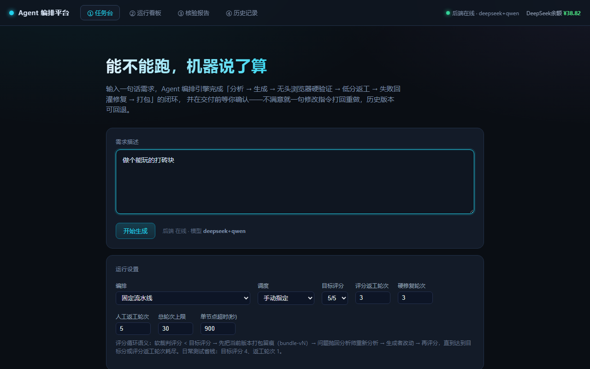
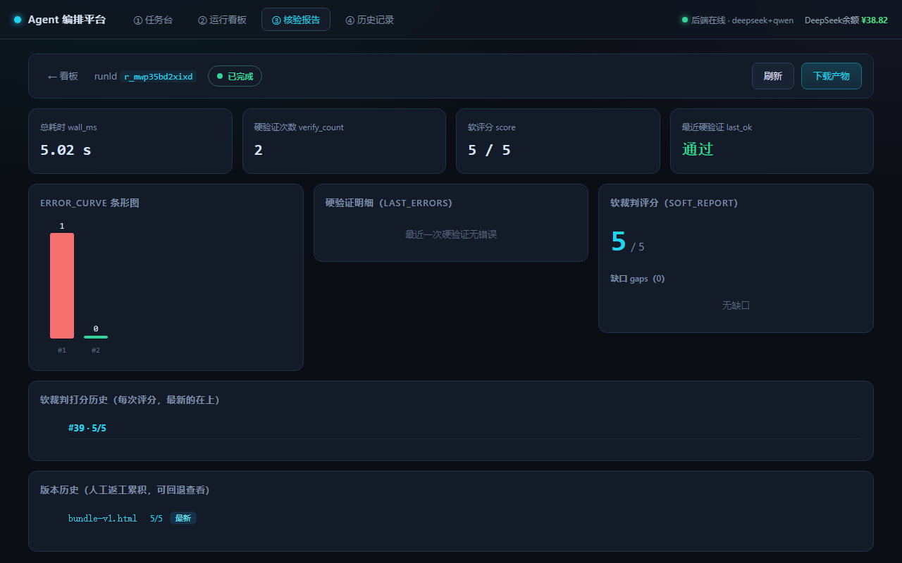
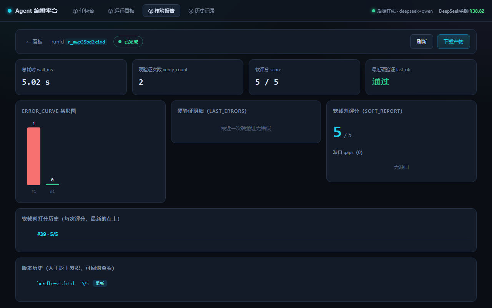
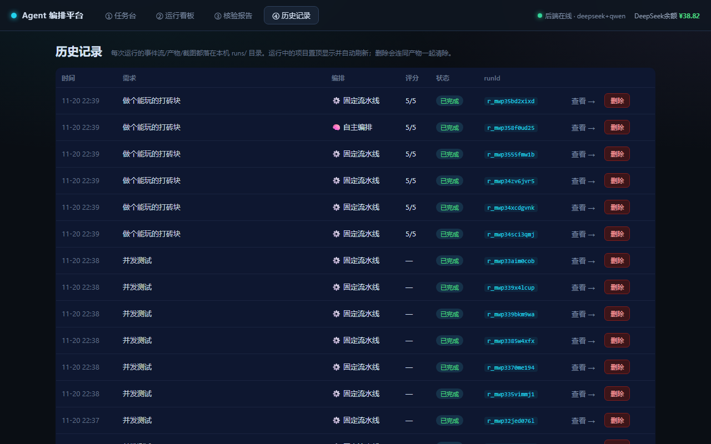

# 多智能体编排调度平台——技术方案书

> **赛题**：第五届"未来杯"创新大赛 · 赛题一（Agent 编排创新应用）
> **队伍名称**：自定义名称1队 **项目名称**：多智能体编排调度平台 **队长**：吴华杰 **指导教师**：无 **学校**：岭南师范学院
> **版本**：2026-11-20 终版（对齐代码当前状态）

**一句话概括**：输入一句话需求，多智能体协作生成单文件 HTML 软件产物，Playwright 无头浏览器硬核验，失败回灌修复、评分未满自动返工、退步自动回滚，交付确定可运行的产物；全程事件流可观测、可秒级中断、可复现、可回退。**核心主张：能不能跑，机器说了算。**

---

## 1 选题背景与场景需求分析

### 1.1 选题背景

大模型应用正从"单轮对话"快速演进为"多智能体协作完成复杂任务"。科研与产业界已涌现出一批 Agent 编排框架（LobeHub、DeepSeek Harness 等），但实际落地仍面临三大挑战：

1. **编排能力薄弱**：现有方案多为脚本化、硬编码的 Agent 流水线，缺乏条件分支、循环控制与异常回退，难以应对复杂任务中的不确定性；
2. **调度策略单一**：多数框架采用简单串行或广播式通信，缺乏基于任务特征、Agent 能力画像与资源负载的动态分配；
3. **验证与可信机制缺失（最致命）**：Agent 输出的中间结果与最终结果缺乏自动化验证与交叉核对，多 Agent 协作中的"幻觉"与错误传播难以收敛，系统可解释性与可复现性不足。

前两个断点的解决方案业界已沉淀出工程共识；**第三个断点至今没有通用解**——因为"验证"依赖一个前提：**产物必须可被机器判定**。绝大多数 Agent 应用产出的是文本、方案或建议，对错无法机械检验，验证只能退化为"另一个大模型看一眼"，而这恰恰把幻觉从执行层搬到了验证层。

### 1.2 场景需求分析

本项目从一个很小的切口进入这个问题：**把任务域收窄到"产物可被机器验收"的软件生成场景，使验证成为硬事实而非软判断。**

**主场景**：输入一句话需求（如"做一个能玩的打砖块"），平台经多智能体协作生成**单文件 HTML/JS 小游戏或交互小工具**，通过无头浏览器硬核验后交付可运行产物，并附带核验报告。

**为什么限定"单文件、无后端、无依赖"**：这是本项目最重要的设计约束，不是能力妥协，而是验证可靠性的前提。运行环境完全确定，因此：产物能否运行是**二值事实**（加载成功、console 报错、pageerror、画布非空、交互脚本不抛错全部可捕获）；错误信息可**无歧义回灌**修复者；同一输入可**完全复现**同一判定。若允许任意产物形态（多文件、依赖安装、后端服务），验证将退化为不可控的环境调试，闭环立刻断裂。

**功能需求清单**（对照赛题六项能力）：

| 赛题要求 | 本平台的实现 |
|---|---|
| Agent 团队定义与管理 | AgentProfile（提示词/版本/能力标签/模型/思考强度/工具白名单/调度指标），候选池与版本管理 |
| 工作流编排 | JSON DAG：顺序/并行/条件/循环/子工作流，六类节点 |
| 智能调度引擎 | 就绪队列 + 并发上限 + pickAgent 打分（成功率·速度·成本），质量优先/省流双档 |
| 工具与外部系统集成 | Function Calling（verify_html 沙箱自检、kb_search 知识库检索）、MCP 客户端（stdio JSON-RPC）、多供应商 LLM 网关 |
| 执行监控与结果验证 | 18 类事件流 + SSE 直推、Playwright 硬验证（非 LLM）、软裁判评分、人工确认点 |
| 反馈与自我优化 | 三层循环（硬修复/评分返工/人工返工）、退步自动回滚、跨运行记忆、知识库 |

**明确不覆盖**：需要人工审美判断的创意产出、需要真实用户数据的业务系统、跨会话持久在线的个人助理场景——这些场景的验证无法机械化，不在本项目射程内。

### 1.3 设计目标

1. **可信**：产物能否运行由机器判定，LLM 无法通过"解释"获得通过；
2. **可干预**：运行中任意时刻秒级中断、插入指令、断点续跑；交付前人工确认，不满意带指令返工；
3. **可复现**：无 API Key 时演示模式（Fake LLM）零成本跑通全流程，评审无需充值即可验证。

---

## 2 平台总体架构设计与技术选型说明

### 2.1 总体架构

```
┌────────── 前端四页（React + Vite）──────────┐
│ ① 任务台   ② 运行看板   ③ 核验报告   ④ 历史记录 │
└───────────────────┬────────────────────────┘
              REST + SSE（事件直推，前端不轮询）
┌───────────────────┴────────────────────────┐
│ 编排引擎 Core（纯逻辑，无 IO 副作用）        │
│ 解析器 → 智能调度器 → 执行器 → 硬验证/质量门控 │
│ → 三层循环控制器 → 人工介入控制器            │
│ + Loop Watchdog（外部只读观察者）            │
└───────────────────┬────────────────────────┘
┌───────────────────┴────────────────────────┐
│ 可插拔能力层：多供应商 LLM 网关 / 沙箱 /      │
│ Function Calling 工具层 / 知识库 / 记忆 /     │
│ MCP 客户端 / 打包器                          │
└───────────────────┬────────────────────────┘
        events.jsonl（唯一事实来源）+ runs/artifacts
```

**核心架构决定：事件溯源（Event Sourcing）。** 系统不维护"当前状态表"，所有状态由 append-only 事件流派生投影。事件类型共 18 类：`run.started/finished/failed`、`node.entered/exited`、`agent.thinking.delta`、`agent.message`（含每次调用的供应商/模型留痕）、`agent.tool.call/result`、`artifact.created`、`verify.hard.result`、`verify.soft.verdict`、`loop.iteration`、`run.interrupted/resumed`、`human.instruction`、`scheduler.picked`、`error`。

一份事件流同时兑现五项能力：执行日志（事件流即日志）、状态快照/可复现（事件流+产物 sha256 可完整重放）、实时监控（SSE 直推）、轨迹统计（对事件流聚合查询时长/轮次/调用）、断点续跑（断点=事件流位置+各节点最新输出引用）。

### 2.2 三条工程原则（用户评审中确立）

1. **事件驱动**：后台任务完成/出错即发事件，订阅者（SSE/Watchdog/前端）被动接收，绝不轮询；
2. **超时熔断**：单节点超过 `timeout_sec`（默认 10 分钟）未完成强制判失败；LLM 单次调用 10 分钟超时中止；
3. **状态剥离**：长耗时任务（模型调用、沙箱验证）交给并发 Worker 批次执行，主循环只做调度与边传播，一次取出至多 `max_concurrency` 个就绪节点并行，不阻塞在单个长任务上。

### 2.3 技术选型说明

| 层 | 选型 | 理由 |
|---|---|---|
| 语言 | TypeScript + Node 20 | 与 Playwright 同生态，前后端共享类型契约 |
| 沙箱 | Playwright（chromium headless） | 可捕获 console/pageerror、可截图、可脚本化交互 |
| 存储 | JSONL 事件流 + 文件系统 | 追加写最契合事件溯源，无需数据库 |
| 前端 | React + Vite，四页 | 任务台/运行看板/核验报告/历史记录 |
| 模型 | 多供应商网关（OpenAI 兼容） | DeepSeek/通义千问等可 `.env` 配置或界面直接接入，Key 仅存本地 |
| 工具调用 | Function Calling（自主实现） | verify_html 沙箱自检、kb_search 知识库检索，调用全过程事件留痕 |
| 知识库 | 轻量确定性检索（src/kb.ts） | knowledge/ 目录 Markdown 切块，关键词打分检索（无向量库依赖） |
| 记忆管理 | 跨运行记忆（src/memory.ts） | 硬修复教训持久化 memory.json，相似错误自动注入修复者提示 |
| MCP | 最小 MCP 客户端（src/mcp.ts） | JSON-RPC 2.0 over stdio，MCP_CMD/MCP_ARGS 接入任意 MCP 服务器 |
| 框架 | **不使用 LangChain / Dify 作为骨架** | 保证调度、验证、自循环三层为自主实现 |

**模块规模**：后端 3,534 行（31 文件）、前端 2,361 行（12 文件），合计约 5,895 行 / 43 文件；54 次 git 提交全链可追溯；20 个 npm 命令。

---

## 3 Agent 角色定义、工作流设计与编排逻辑详解

### 3.1 Agent 角色定义

平台定义 5 类角色，其中 **1 类不是 LLM**——这是刻意的设计：

| 角色 | 类型 | 职责 | 输入 → 输出 | 工具 |
|---|---|---|---|---|
| 分析师 analyst | LLM | 把一句话需求拆成可机械验收的规格；返工轮结合裁判差距+上一版代码+用户指令重新分析，输出修订规格与 `changes` 具体修改要求 | 需求(+返工材料) → DecompositionSpec | kb_search |
| 生成者 builder | LLM | 产出单文件 HTML；返工轮基于上一版**增量修改**（不推倒重做） | 规格(+上一版) → HtmlArtifact | verify_html, kb_search |
| **硬校验器 hard-sandbox** | **确定性脚本** | 无头浏览器加载、捕获报错、截图、判定 | 产物 → HardReport | — |
| 软裁判 critic | LLM | 对照验收条件打分 1~5、指出差距；**对比历史各版判断进步/退步** | 产物+规格+历史 → SoftReport | — |
| 修复者 fixer | LLM | 吃错误卡片/改进卡片重写产物 | 卡片+规格+摘要 → 新产物 | verify_html |

每个角色是一个 `AgentProfile`：角色提示词（版本化）、思考强度（低/中/高）、模型（供应商可任意）、能力标签、工具白名单、记忆范围、输出 Schema、**调度指标（历史成功率/平均耗时/成本档位）**。

**分析师输出契约（关键设计）**：除 `acceptance[]`（每条必须能被程序判定真假）、`assumptions[]`、`ambiguities[]`（标 blocking）外，还输出 `tasks[].spec`（任务书级实现要点：数据结构、状态变量、更新规则、数值区间、交互映射、边界情况）与 `changes[]`（返工轮具体修改点）。阻塞性歧义数 > 0 时**停机转人工**，而不是猜下去——**任务本身有歧义时，停在歧义点比猜错三个节点便宜。**

### 3.2 工作流设计

工作流用 JSON 描述为 DAG（含回边成环，`entry` 显式声明入口），节点支持 `agent / verify / packager / human / gate / subflow` 六类，边支持：顺序（单边链）、并行分支（同源多边）、条件判断（`when: always/pass/fail`）、循环迭代（回边 + `loop.max_iters` + 超限兜底 `on_exhaust`）、子工作流（`subflow` 节点）。

**循环不做特殊处理**：回边在运行时等价于"该节点重新入队"，靠局部 `loop.max_iters` 与全局 `limits.max_total_iters` 双重兜底，既保留 DAG 的静态可校验性，又支持迭代。

**主工作流 `game-gen-v4`（固定流水线模式）**：

```
分析 → 生成 → 硬验证 ──失败──> 修复者 ──循环(≤3轮)──> 硬验证
              └─通过─> 软裁判评分 ──> 质量门控
                          ├─ 达目标分 ──> 交付打包 ──> 人工确认点
                          │                            ├─ 接受 ──> 完成
                          │                            └─ 返工(带指令) ──回分析师──> 生成者增量改──> …
                          └─ 未达目标分 ──> 版本留痕(bundle-vN) ──> 回分析师(读代码+差距+历史教训)
                                └──> 生成者增量改 ──> 再验证再评分 ──> 循环(轮次可配，默认3/上限9)
```

**自主编排模式 `auto-plan-v2`**：分析师额外输出**开发计划**（2~4 步，每步含验收点），引擎确定性地把计划逐步编排为「生成 → 硬验证 → 失败修复」子流程（subflow 节点），上一步产物增量传给下一步；后续评分/返工/人工确认与固定模式共用同一套门控。**LLM 只提供计划数据，步骤编排由引擎代码执行**——控制面确定性红线在动态编排下依然成立。

### 3.3 编排逻辑

- **OR 激活调度**：任一条入边条件满足即触发目标节点；就绪节点入队按序消费；
- **批量并发**：一次取出至多 `max_concurrency` 个就绪节点交给并发 Worker，主循环只等一批结果（事件驱动，非轮询）；
- **节点级超时熔断**：超时强制判失败，错误入事件流；
- **循环计数**：回边带独立计数器，超限走 `on_exhaust` 兜底（如评分返工耗尽 → 仍打包带缺陷交付）；
- **人工节点**：运行到 `human` 节点即暂停（批量实验可关），等"接受 / 返工"决定；
- **秒级中断**：`interrupt()` 直接 Abort 在途 LLM 调用与沙箱验证（实测 1ms），被中止节点重新入队，续跑后从头再跑。

---

## 4 调度算法与自我循环机制说明

### 4.1 智能调度算法

**调度模型**：OR 激活 + 就绪队列 + `max_concurrency` 并发上限。Agent 分配由 `pickAgent(node, candidates[])` 完成，打分函数（各分量归一化到 0~1）：

```
score = w_succ·成功率 + w_speed·速度 + w_cost·便宜度
```

权重随**调度档位**切换：质量优先 `{1.0, 0.05, 0.03}`（选强模型），省流 `{0.3, 0.2, 0.5}`（选便宜模型）。四个分量来自角色画像（bench 实测成功率 0.95、平均耗时 203s、成本档位）。**实测**：同一生成节点（候选 `builder` / `builder-flash`）在两档下分别选中 builder（0.983 vs 0.915）与 builder-flash（0.768 vs 0.417）；打分过程以 `scheduler.picked` 事件留痕，调度随运行积累可自我修正。

**控制面确定性（红线）**：节点跳转、调度打分、质量门控、退步回滚、版本恢复、错误归一化**全部是确定性代码，禁止 LLM 决定"下一步谁执行"**。业界实测表明，把"是否分派、分派给谁"交给模型临场判断会出现不可控长尾且不可复现。**能写成 if 的判断，绝不交给模型。**

### 4.2 三层自我循环机制

1. **硬修复循环（≤3 轮）**：硬验证失败 → 错误归一化（N 条报错 → ≤3 张错误卡片，分类语法/运行时/渲染/交互，附行号与截图；归约器是确定性代码，禁用 LLM）→ 回灌修复者（只喂卡片+规格摘要，控 token）→ 轮次+1；
2. **评分返工循环（轮次可配，默认 3、上限 9）**：软裁判打分未达目标分（默认 5，可调 3/4/5）→ **先把当前版本打包留痕（bundle-vN，每次未满分的尝试都可追溯）** → 差距压成改进卡片 → **回分析师**（输入：原始需求+裁判差距+上一版完整代码+历史教训 run_memory）→ 分析师输出修订规格+changes → **生成者基于上一版增量修改** → 再验证再评分；
3. **人工返工循环（≤5 轮）**：人工确认点拒绝并附指令 → 回分析师（结合指令+当前版本重新分析）→ 生成者增量改 → 再走完整验证闭环。

**两条防退步机制**：门控持续记录历史最优版本，新版评分低于最优 → **自动把工作基底回滚到最优版本**并附说明卡片；用户说"返回第一版 / 回到第 N 版" → 引擎直接从 `bundle-vN.html` 恢复该版本作为后续修改基底。实测（demo:rollback）：构造"4 分 → 返工后 2 分"退步场景，门控自动回滚并留卡片；人工指令「返回第一版」触发回滚事件，全程 4 个版本文件可查，最终正常交付。

### 4.3 收敛保证（Loop Watchdog）

主系统之外的独立只读模块订阅事件流、只看硬信号，四道闸门保证"循环一定会停"：

1. **轮次上限**（各循环局部上限 + 全局 `max_total_iters`）；
2. **调用指纹去重**：`hash(节点+规范化载荷)` 重复，或错误卡片集合与上轮相同 → 判"卡住"立即升级；
3. **错误数连续两轮不降** → 升级策略（拆更细子任务/提高思考强度/请求人工）；
4. **超限带缺陷交付**：输出历史最优可运行版本+缺陷报告（错误分类/行号/截图/已尝试修法/各版本评分），绝不假装成功。

实测（demo:stall）：修复者连续输出相同坏产物 → Watchdog 判"假进展"中止并升级，运行以 `failed` 诚实收尾。

---

## 5 结果验证策略与反馈优化逻辑

### 5.1 两级判定（Fast Path / Slow Path）

| 层级 | 判定者 | 判定对象 | 是否阻断 |
|---|---|---|---|
| L1 硬验证 | 沙箱脚本（**非 LLM**） | 能否加载、有无报错、交互是否抛错、渲染是否非空 | **是**，失败即回灌 |
| L2 软验证 | LLM 裁判 | 验收条件满足度 1~5 分、相对历史的进步/退步 | 否，作为质量门控输入 |
| L3 人工 | 用户 | 最终验收 / 中途干预 / 返工指令 | 是 |

**硬验证判定公式（写死）**：`ok = 页面加载成功 && 控制台/页面错误 = 0 && (图形类: canvas 非空 | 工具类: DOM 节点 ≥ 12) && 交互脚本不抛错`。图形类/工具类由分析师在规格中声明（`graphic` 字段），避免"工具类产物被 canvas 判定误杀"。

### 5.2 反馈优化逻辑（闭环全景）

```
硬验证失败 → 错误卡片(确定性归约) → 修复者(可查知识库/历史经验/自检工具)
软裁判低分 → 改进卡片 → 版本留痕 → 分析师(读代码+差距+教训) → changes → 生成者增量改
运行结束 → 硬修复教训写入跨运行记忆 memory.json（成功/失败都记）
新运行修复者遇相似错误 → 自动注入[历史经验]（实测第二次运行即命中）
```

质量门控、退步回滚、版本恢复、错误归一化**全部是确定性代码**——反馈优化的"何时返工、从哪个版本继续、给谁什么卡片"没有一步是 LLM 决策，保证可复现、可审计。

---

## 6 核心代码模块说明与系统截图

### 6.1 核心代码模块

| 模块 | 文件 | 职责 |
|---|---|---|
| 编排引擎 | `src/engine/engine.ts` | DAG 解析、就绪队列调度、三层循环、秒级中断、退步回滚、工具执行 |
| Loop Watchdog | `src/engine/watchdog.ts` | 只读观察者，判"有无实质进展" |
| 角色定义 | `src/agents/*.ts` | AgentProfile（提示词、输出 Schema、调度指标、工具白名单） |
| 硬验证沙箱 | `src/sandbox/sandbox.ts` | Playwright 加载、报错捕获、交互脚本、截图、中断中止 |
| 错误归一化 | `src/reducer.ts` | 确定性压缩错误卡片（禁用 LLM） |
| LLM 网关 | `src/gateway/llm.ts` | 多供应商路由、超时熔断、中断中止、用量计量、Function Calling 工具循环 |
| 知识库 | `src/kb.ts` + `knowledge/` | 轻量确定性检索（关键词打分） |
| 记忆管理 | `src/memory.ts` | 跨运行教训持久化与检索注入 |
| MCP | `src/mcp.ts` + `examples/` | MCP 客户端（stdio JSON-RPC）+ 示例服务器 |
| 工作流定义 | `src/workflows/game-gen.ts` / `auto-plan.ts` | 固定流水线 / 自主编排 |
| 事件存储 | `src/event/store.ts` | append-only 事件流与重放 |
| 实验流水线 | `src/bench/*.ts` | 数据集（含高难度组）、批量 runner、三策略对比、并发测试 |
| 打包器 | `src/packager/packager.ts` | 版本化单文件产物输出（bundle-vN） |
| 服务端 | `src/server.ts` | REST+SSE、历史扫描、删除、余额、供应商管理、演示模式 |
| 前端 | `web/src/` | 任务台/运行看板/核验报告/历史记录四页 |

### 6.2 系统截图

**任务台**（需求输入 + 开始生成 + 运行设置/角色配置/接入 API 面板）：




**运行看板**（节点状态 + 实时事件流 + 产物预览，事件按角色着色）：



**核验报告**（硬验证明细 + 软裁判打分历史 + 版本历史）：



**历史记录**（运行持久落盘、状态/评分/删除）：



---

## 7 测试用例、运行效果与性能评估

### 7.1 测试用例（20 个命令 + 专项测试）

**命令行测试**：`demo:single`（最小闭环）、`demo:workflow`（全链路含故意出错修复）、`demo:stall`（卡死检测）、`demo:interrupt`（秒级中断续跑）、`demo:gate`（歧义停机）、`demo:quality`（评分返工收敛）、`demo:confirm`（人工确认/返工/版本化）、`demo:scheduler`（调度打分双档）、`demo:auto`（自主编排）、`demo:rollback`（退步回滚+返回第一版）、`demo:real`（真实模型）、`bench`/`compare`/`summary`/`charts`（批量实验）、`replay`（事件重放）。

**专项测试（本轮新增）**：
- `test:mcp`：MCP 客户端跑通（initialize→tools/list→tools/call，实测 add(2,3)=5、multiply(4,5)=20）；
- `test:memory`：跨运行记忆存取/检索 + 教训注入修复者（第二次运行命中[历史经验]）；
- `test:concurrency`：并发批处理实测。

全部测试命令**无 API Key 亦可运行**（演示模式 Fake LLM），评审零成本复现。

### 7.2 运行效果

**20 条样本实验（5 类 × 4 条）**：首轮可运行率 **95%（19/20）**，最终 **100%（20/20）**；唯一首轮失败（贪吃蛇+排行榜，1 条报错）经 1 轮修复收敛，错误曲线 `[1,0]`。

**三策略消融对比**（同一批样本、同一 L1 硬验证口径、同一模型）：

| 策略 | 可运行数 | 可运行率 |
|---|---|---|
| S1 串行单 Agent（基线） | 17/20 | 85% |
| S2 多 Agent 无核验 | 18/20 | 90% |
| **S3 本方案（核验+修复+看门狗）** | **20/20** | **100%** |

**结论：软裁判只带来 5 个百分点（85%→90%），硬验证+修复闭环带来 15 个百分点（85%→100%）——增益来自"验证角色与执行角色的对抗"，而非 Agent 数量。**

**持续实证规模**：平台累计真实运行 **303 次**，落盘 **109 个版本文件**——循环、返工、版本追溯不是文档名词，而是反复执行过的机制。

### 7.3 性能评估

| 指标 | 数值 | 说明 |
|---|---|---|
| 单任务耗时 | p50 = 203 s，p95 = 404 s | 长尾来自机制微创新类样本的深度推理 |
| 并发批处理 | **1.99x** | 4 个并行验证节点：串行 1489ms → 并行 748ms（演示模式实测） |
| 中断响应 | **1 ms** | 直接中止在途模型调用与浏览器验证（模拟 30s 调用实测） |
| 实验成本 | 161 次调用约 ¥9.47 | 三策略对比（闲时计价）+ 基准实验 ¥3.71 |
| 修复收敛 | 中位数 0 轮、最大 1 轮（20 样本） | 硬上限 3 轮 |

### 7.4 局限与诚实披露

1. L1 只证明"能跑"，不证明"好玩"——图形类依赖 canvas 非空等弱信号，主观部分交由软裁判与人评；
2. 样本 20 条、单模型单次采样，结论不可外推；高难度补充实验（弹幕射击/平台跳跃）已备数据集与跑批命令，受预算限制未跑完；
3. 简单任务域硬修复循环触发率低（1/20），评分返工循环因目标分默认 5 分触发更频繁，但未做大规模统计；
4. 分析师拆解错误会向后传导——歧义停机/退步回滚/裁判对比历史是缓解手段，无法根除；
5. 多 Agent 每一跳都是一次 LLM 往返，简单任务耗时高于单 Agent，本项目不以"更快"为卖点，以"一次通过率与可信交付"为卖点；
6. 循环轮次与成本的权衡：评分返工开满（9 轮全强模型）会显著放大 token 成本，平台把轮次/目标分做成运行级可配置，让用户在钱与执着之间自行权衡。

---

## 8 人工智能使用说明（各环节 LLM、RAG、MCP 的实际作用、贡献与局限）

### 8.1 各环节使用情况

| 环节 | 使用了什么 | 实际作用 | 边界（哪些判断没交给它） |
|---|---|---|---|
| 需求拆解 | LLM（分析师） | 自然语言需求 → 可机械验收的规格 | 是否停机追问由规则判定（阻塞性歧义计数>0） |
| 产物生成 | LLM（生成者） | 产出/增量修改单文件 HTML | 结构由规格约束，不得自选技术栈 |
| 运行验证 | **不使用 LLM** | — | "能不能跑"完全由沙箱脚本判定 |
| 质量评价 | LLM（软裁判） | 对照验收条件打分、对比历史指出退步 | 不阻断交付；是否返工由质量门控规则判定 |
| 错误修复 | LLM（修复者） | 依据错误卡片重写 | 修几轮由轮次上限与指纹去重控制 |
| 错误归一化 | **不使用 LLM** | — | 确定性代码压缩错误卡片 |
| 任务分派/调度打分 | **不使用 LLM** | — | WorkflowDef+状态机+打分函数，禁止模型改拓扑 |
| 质量门控/退步回滚/版本恢复 | **不使用 LLM** | — | 确定性代码 |
| 进展判断 | **不使用 LLM** | — | Watchdog 只读硬信号 |
| 自主编排 | LLM 只出计划数据 | 分析师拆步骤 | 步骤如何编排执行由引擎代码决定 |
| 知识库 | 轻量检索（非生成式） | kb_search 工具返回相关规范条目 | 检索确定性关键词打分，无向量库 |
| 记忆管理 | 结构化存储（非生成式） | 历史教训注入修复者提示 | 检索确定性，不参与控制流 |
| MCP | 协议客户端 | 接入外部工具服务器 | 工具调用由模型发起、引擎执行、事件留痕 |

### 8.2 贡献与局限

**LLM 的贡献**：把自然语言需求翻译成可验收的规格、生成与迭代修改代码、对"好不好"做语义评价——这是 LLM 不可替代的部分；**平台用三层循环与确定性门控把这些能力装进收敛的框架里**。

**LLM 的局限与对策**：输出不稳定（→ 输出必须过 JSON Schema，非法即报错重试）；会自我说服（→ 能否运行由沙箱判定，它无权辩解）；会越改越差（→ 裁判对比历史 + 门控自动回滚到最优版）；幻觉（→ 修复者只拿到机器实测的错误卡片，不喂未经证实的自述）。**一句话：LLM 负责"生成"与"评价好不好"，不负责"判定能不能跑"，也不负责"决定何时停、改哪个版本、分派给谁"。**

---

## 附录 A 复现指南

1. 下载仓库 https://github.com/pppaio/futurecup-agent-orchestrator，解压；
2. 双击根目录 `start.bat`（自动装依赖、下载无头浏览器、启动服务并打开 http://localhost:3000）；或命令行 `cd agent-platform && npm install && npx playwright install chromium && npm run serve`；
3. **不配置任何 API Key 时自动进入演示模式（Fake LLM）**，全流程零成本跑通；接入真实模型：任务台「接入 API」面板填 Key，或 `.env` 填 `DEEPSEEK_API_KEY`；
4. 3 分钟演示路径见仓库《安装与使用说明.md》；20 个命令行测试 + `test:mcp` / `test:memory` / `test:concurrency` 一键验证。

## 附录 B 提交材料清单

| 材料 | 位置 |
|---|---|
| 本方案书（PDF） | 仓库 `docs/方案书.pdf` |
| 讲解 PPT（按官方模版） | 仓库 `docs/讲解PPT-按模版.pptx`（17 页） |
| 项目白皮书 | 仓库 `docs/项目白皮书.md` |
| 演示视频素材 | 仓库 `docs/演示视频-自动录屏素材.webm` + 《视频脚本-终版》 |
| 可运行代码 | https://github.com/pppaio/futurecup-agent-orchestrator |
